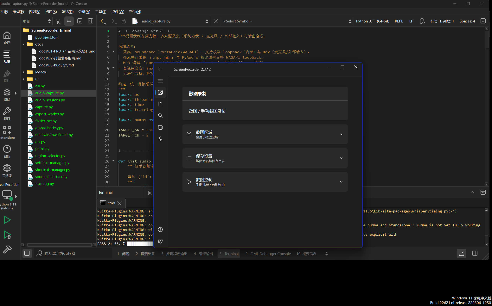
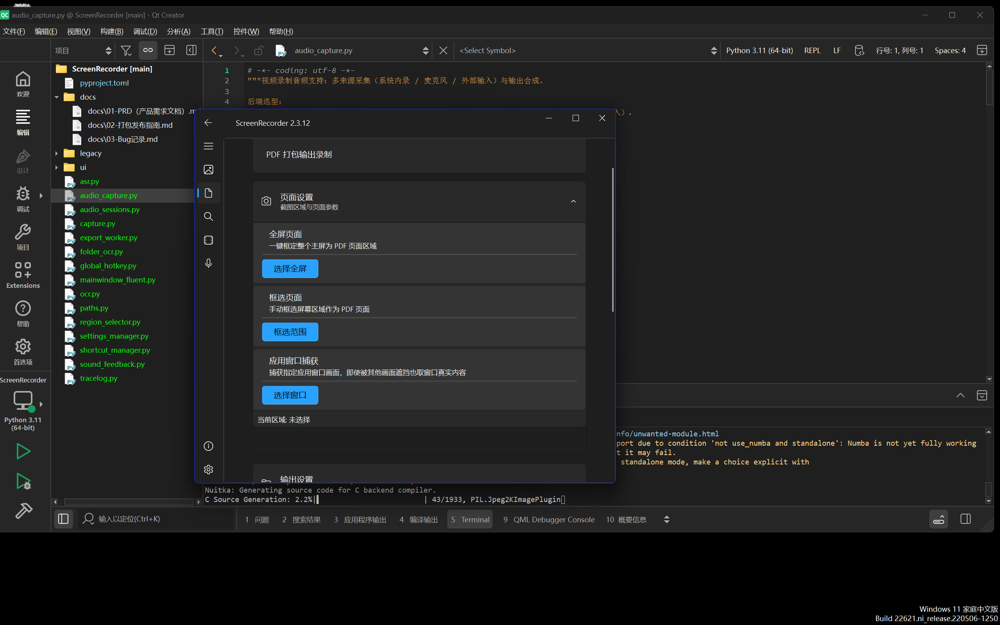
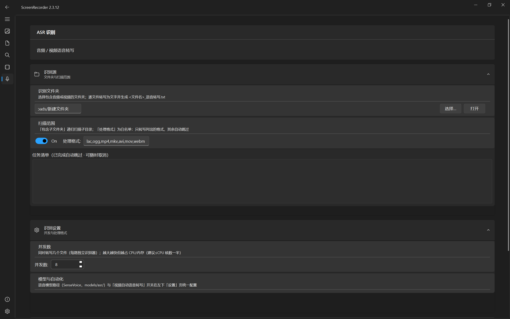
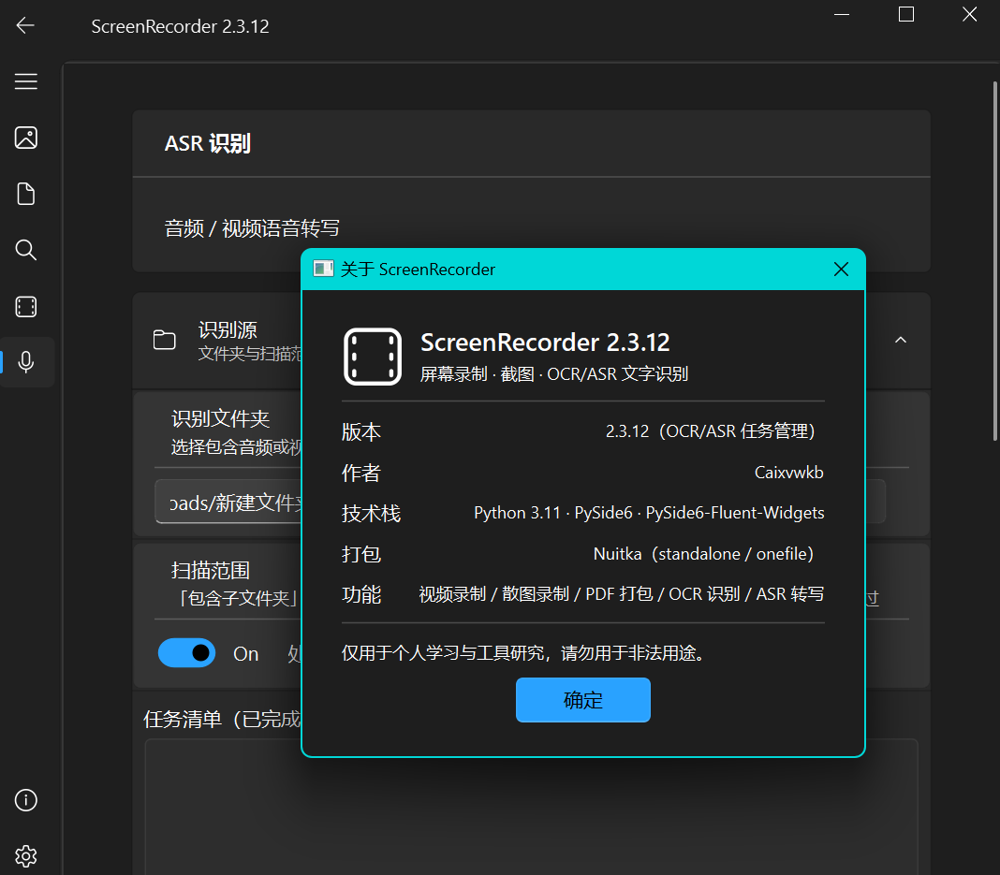

# ScreenRecorder

> 版本 **2.3.13** · 作者 **Caixvwkb**
> **把屏幕变成能批量加工的素材：截图、录屏、OCR、语音转写，一条流水线全搞定。**

一款现代化桌面工具：录屏、截图、PDF 打包、OCR 文字识别、ASR 语音转写，全部本地模型、后台待命、快捷键直达。不用注册、不用联网、不用装全家桶——**转文本模型随程序外置，拷贝即用**。

- **现代化 UI**：基于 PySide6-Fluent-Widgets 的 Fluent 设计语言——流畅动画、侧边导航、开机就是它该有的样子。

几张软件截图（深色主题，2.3.x）：









- **全程后台待命**：最小化也能用，不打断正在操作的窗口。

  批量截取会话进行中，`Enter` 全局生效（框选即截）；会话结束自动释放，不占用其他软件的回车键。
  `Ctrl+S` 开始 / `Ctrl+P` 停止等快捷键在软件窗口内随时响应，可自定义并持久化；热键不写入系统注册表，绿色无残留。

- **本地模型，隐私安全**：OCR / 语音识别 / 标点恢复全部本地运行，文件不出电脑。

- **批量处理（设计的主要目标）**：多文件并发、完成一个输出一个、未完成的自动重传——OCR/ASR 各选一个文件夹，里面的图片或音频全自动处理完，不用逐个添加。

---


## 典型使用场景

### 场景一：网上下载的视频，一键提取文本当学习语料

- **痛点**：网课、公开课、访谈视频收藏一堆，抽不出时间一集集看，AI 又读不了视频；想查某段内容还得反复拖进度条。
- **怎么用**：把视频下载好（mp4 / mkv / mov）丢进 **ASR 语音转写** → 自动抽音频、长音频分段、多文件并行 → 每集输出一份带**时间戳字幕**的文字稿（照着时间戳能定位到视频任意一句话）→ 丢给 AI 就能生成笔记、总结、问答。
- **附加价值**：自己录的会议、课堂录音同样适用（同一功能）；批量一次跑完、未完成自动重传；文字稿既是学习语料，也能当字幕用。**全程本地处理，视频不上传云端，隐私无忧**——对比需要联网上传的通义听悟、Ai好记等，这是本地工具的差异化优势。


### 场景二：课件照堆成山，AI 看不清就编——OCR 转成文字，它才说真话，发现AI幻觉

- **痛点**：课件照片攒了几百张，想找"那张讲 XXX 的"——只记得大致内容，一张张翻到崩溃；丢给 AI 更糟：它看不清图片时**不会承认，直接编造内容**，你根本分不清哪些是真的；想纠正还得描述"第几张、实际长什么样"，比翻还麻烦。
- **怎么用**：把照片文件夹拖进 **OCR 识别** → 每张图生成一个 `<文件名>_说明.md`（文件名与内容一一对应）→ 勾上**合并输出**合成一个汇总 md → 直接丢给 AI："帮我找讲 XXX 的课件"——它读得懂、答得快，还能直接告诉你在哪个文件。
- **附加价值**：一次 OCR 长期复用，之后随时查；AI 直接读文字，不用反复喂图片，省 token 也更稳；顺手还能做错题集、整理知识点。**换个用法就是"图片转笔记语料"**——课件、板书、书本、纸质资料，凡是拍下来的图，一键变成可整理的文字稿，丢给 AI 就能基于它生成笔记。


### 场景三：批量抓取屏幕内容，截完直接打包成册、提取文字

- **定位**：散图录制的本职是**批量采集**，不是单张随手截——选好区域和间隔，软件自动连拍一批图，截完直接打包 PDF 或提取文字。
- **痛点**：翻网页、文档、题库要一张张截图保存，截完一堆散图还不好管理；想转文字还得另想办法。
- **怎么用**：框选要采集的区域（或全屏）→ **手动模式**逐张截取（`Enter`）或**自动模式**按设定间隔连拍 → 截完的散图直接 **PDF 打包**成册（翻阅 / 打印 / 存档）→ 需要文字就开 **OCR**，自动生成每张图的文字说明。
- **典型用途**：题库逐题截图、网页 / 文档批量采集、课件逐页抓取——截一批、成册、转文字，一条龙。


### 场景四：附带功能——随手录个小视频

- **定位**：录屏定位为轻量补充功能，覆盖"随手录一小段"的日常场景——录操作流程发给同事、录演示给家人、录软件教程，打开就录，不用研究参数。
- **痛点**：别的录屏软件要么操作繁琐、界面复古，要么像 OBS 这类专业工具，参数一大堆，对"录个 2 分钟小视频"来说全是冗余。
- **能录什么样**：画面（**全屏 / 框选区域 / 只录指定应用窗口**，不被弹窗遮挡）+ 声音（**系统内录 / 麦克风讲解 / 内外双路**；选 MP3 模式则只录音频）+ 帧率（**24 / 30 / 60 FPS** 挡位，dxcam 高效抓帧，办公流畅不卡顿）+ 格式（**mp4 / avi / mkv / mov**）。
- **怎么用**：选区域 → 选声音来源 → 点开始；`Ctrl+S` 开始 / `Ctrl+P` 停止，快捷键操作，不用切出当前窗口。


---

## 模型外置：默认已配好，也能自己换

**打包分发版开箱即用**：发布包已把模型配置好，整个 `models` 文件夹随程序一起分发——打开软件直接运行exe使用，**小白不用碰任何设置**。

**软件默认使用的模型**：

- **OCR**：ch_PP-OCRv4（检测 + 识别 + 方向分类）
- **ASR**：SenseVoice int8（中英日韩粤）+ CT-Transformer 标点恢复

**想换模型？两种方式**：

1. **直接替换**：把新模型文件改成同名（如 `model.int8.onnx`）覆盖到对应目录
2. **改配置**：编辑 `models/ocr/config.json` 或 `models/asr/config.json`，把模型文件名改成你的（OCR 的 det / rec / cls 字段、ASR 的模型文件字段）

```
models/
├── ocr/        # ch_PP-OCRv4 检测+识别+方向分类（det/rec/cls onnx）+ config.json
├── asr/        # SenseVoice int8（model.int8.onnx + tokens.txt）+ config.json
│   └── punct/  # CT-Transformer 标点恢复模型
└── sounds/     # 操作音效（ok.wav / click.wav / fail.wav）
```

模型缺省时回退内置默认配置，并打印「配置来源: config.json（外置）/ 内置默认」日志方便排查。

---

## 项目结构

```
screen_recoder/
├── mainwindow_fluent.py   # 入口：窗口框架 + 导航 + 装配（业务逻辑不在入口）
├── ui/
│   ├── widgets.py         # 通用控件（TwoRowCard / 目录选择卡 / 状态行）
│   └── pages/             # 5 个功能页控制器（video / image / pdf / ocr / asr）
├── capture.py             # 录屏核心（dxcam 抓帧）
├── audio_capture.py       # 音频采集（WASAPI 内录 / 麦克风 / 双路 / MP3 仅音频）
├── audio_sessions.py      # 音频会话检测（comtypes）
├── region_selector.py     # 框选录制区域
├── global_hotkey.py       # 全局热键（RegisterHotKey + native 事件过滤）
├── ocr.py                 # OCR 引擎（rapidocr + 外置模型）
├── folder_ocr.py          # 文件夹批量 OCR（图片 / PDF）
├── asr.py                 # ASR 引擎（sherpa-onnx SenseVoice + 标点恢复）
├── export_worker.py       # 后台任务线程（批量任务 / 取消 / 即时输出）
├── shortcut_manager.py    # 快捷键管理与持久化
├── sound_feedback.py      # 操作音效反馈
├── paths.py               # 路径解析（程序根 / 缓存 / 日志）
├── tracelog.py            # 日志（滚动文件 + 控制台）
├── settings_manager.py    # 设置持久化
├── models/                # 外置模型（热加载，打包不内嵌）
├── docs/                  # 文档三件套
└── legacy/                # 旧版 UI 存档（参考用，不参与构建）
```

架构原则：**前端页面独立（ui/pages）、后端能力模块独立、入口只做装配**；页面与后端通过 Qt 信号槽连接；模型全部外置，配置走 `config.json`。

## 技术要点：踩过的坑

| 问题 | 解法 |
|---|---|
| Nuitka 打包卡死 / NuitkaOptimizationError | torch / sympy 必须 `--nofollow-import-to`（未被直接使用，纯依赖污染） |
| soundfile 报 "module not a package" | soundfile 是单文件模块，DLL 在 `_soundfile_data` 包：`--include-package=_soundfile_data --include-package-data=_soundfile_data` |
| Qt6 全局热键注册成功但永远收不到 | `RegisterHotKey` 必须传真实窗口句柄（`winId()`）；NULL 句柄不触发 nativeEventFilter |
| 裸 Enter 全局热键干扰其他软件 | 只在批量截取会话期注册 / 结束注销，不常驻 |
| SenseVoice 长音频内存爆炸 | 分段识别（30s 段 + 1s 重叠），段级并行 + 多文件交错进池 |
| 打包版 OCR 静默失效（只出文件名没内容） | 模型外置热加载（models/ + config.json）+ 日志打印实际加载路径与配置来源 |
| rapidocr config.yaml 打包缺失 | `--include-package-data=rapidocr_onnxruntime` |
| WASAPI 线程模式冲突（WinError -2147417850） | comtypes 在专用线程 CoInitializeEx |
| PDF 输出 QFont 点大小 <= 0 | 使用前校验字体点大小，非法值回退默认 |

---

## 详细文档（docs/）

从 1.0 初版到 2.3.13 的完整创作记录都在 `docs/` 文件夹：

| 文档 | 内容 |
|---|---|
| **01-PRD（产品需求文档）** | 设计需求全记录：1.0 初始建模 → 2.1 UI 重构 → 2.2 性能优化 → 2.3 批量任务主线，每一次版本迭代为什么这么改 |
| **02-打包发布指南** | 打包命令（按版本时间序）、配置、踩坑、模型分发 |
| **03-Bug记录** | 所有版本修过的 Bug 时间线，含根因与处理 |

这份软件最初只是"录屏工具"的文字设想，一路迭代成现在的截图 / 录屏 / OCR / ASR 四模块工具——每一步决策、每个坑、每个版本，都在文档里。

